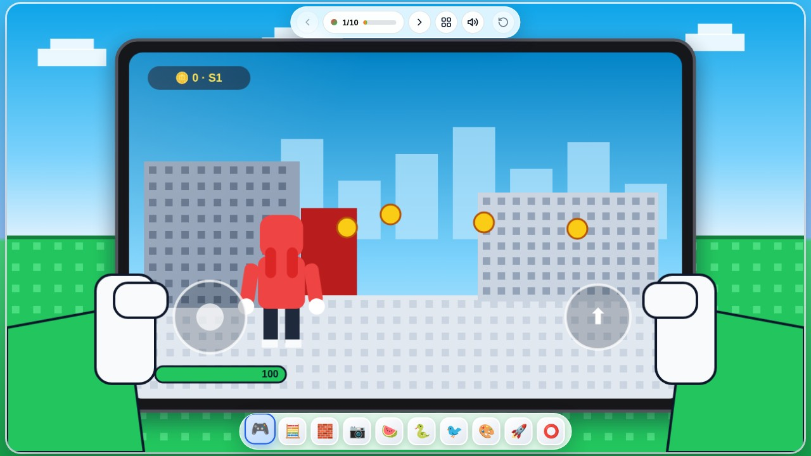

# Maizen: Roblox INSIDE Roblox iPad Simulator

Interactive JJ & Mikey iPad-inside-Roblox playground with **10 playable apps** faithfully reproducing [**How JJ and Mikey to PLAY Roblox INSIDE Roblox? - Maizen**](https://youtu.be/Do9uo62h_d8).

**Live Game**: https://kunruiw1991.github.io/maizen-roblox-inside-roblox/

## All 10 Playable iPad Apps
1. **Roblox INSIDE Roblox Obby (`🎮`)**: Run & jump JJ across studded blocks & ramps with green `100` HP bar & touch controls.
2. **Calculator 67 (`🧮`)**: Working iOS calculator with dedicated `67` meme trigger.
3. **Block Blast (`🧱`)**: `8×8` royal-blue polyomino puzzle with full row/column line clears.
4. **FaceTime & Mikey Camera (`📷`)**: Wave to Mikey on the sunny plaza & snap a custom Home Wallpaper.
5. **Fruit Slice (`🍉`)**: Swipe flying watermelons, oranges & lemons across the wooden cutting board.
6. **Snake Arena (`🐍`)**: Steer your glowing cyan-striped snake & eat neon orbs to grow huge.
7. **Flappy Wings (`🐦`)**: Tap to flap between bright green pipes.
8. **Creative Draw Pad (`🎨`)**: Multi-color freehand drawing + 1-tap `MIKEY NOOB / 67` stamp.
9. **Space Defense (`🚀`)**: Blast UFO saucer waves under ringed Saturn.
10. **Couch Tic-Tac-Toe Finale (`⭕`)**: JJ (`X`) vs. Mikey (`O`) on the plaza studio couch!

## Per-Module Parallel QA & Verification
- Unit Tests: `node --test --experimental-test-coverage tests/unit.test.js` (95.91% line coverage)
- Multi-Viewport Playwright E2E + Comparison Grid: `python3 tests/e2e_verify.py`
- Side-by-side visual audit grid: [`.qa/comparison_grid.png`](.qa/comparison_grid.png)
- Audited in parallel per-module by **Claude Opus 5.5 (`extra`)** and **Codex GPT Astra (`medium`)** (Module 1 PR #1 + Module 2/Final PR #2).
